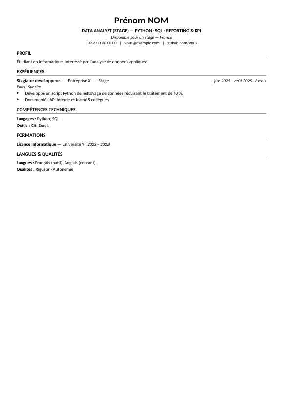
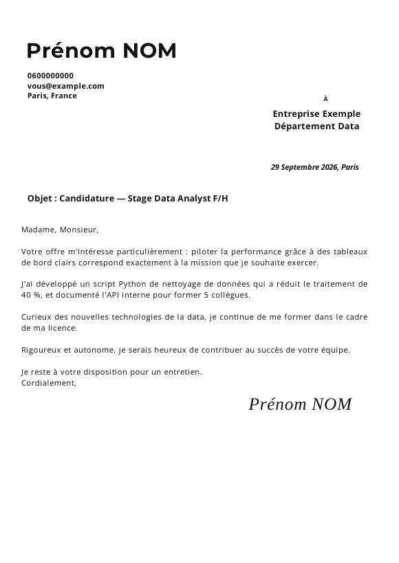

# Agent de candidatures IA

[](https://github.com/VOTRE-COMPTE/agent-candidatures-ia/actions)

Un agent construit avec l'API Claude qui **repère des offres de stage ou d'alternance**, **adapte le CV**
à chacune, **rédige la lettre de motivation** quand elle est demandée, prépare l'e-mail — et
**n'envoie rien sans validation humaine**.

Projet réalisé dans une démarche d'apprentissage des agents IA : chaque étape est traçable
(`tailoring.json`, `letter.json`) et chaque texte généré est contrôlé par du code, pas seulement par un prompt.

| CV adapté à l'offre | Lettre au gabarit fixe |
|---|---|
|  |  |

*Exemples avec un profil fictif.*

## Fonctionnement

```
Sources (RSS · pages carrières · alertes e-mail)
   → déduplication (SQLite) → filtre mots-clés → notation Claude (0-100)
   → adaptation du CV (.docx) [+ lettre .pdf/.docx si l'offre la demande] + brouillon d'e-mail
   → relecture et approbation par l'utilisateur → envoi SMTP (plafond quotidien)
```

Ce n'est volontairement **pas** un agent totalement autonome : c'est un enchaînement d'étapes fixes,
plus prévisible et moins coûteux, avec l'humain au centre de la décision d'envoi.

## Ce qui est adapté à chaque offre

| Élément | Adaptation | Limite imposée par le code |
|---|---|---|
| Titre du CV | Intitulé de l'offre + 3 spécialités | Mots présents dans l'offre ; spécialités issues du profil |
| Résumé | Réécrit pour l'offre | Aucun chiffre absent du profil |
| Compétences | Catégories et items réordonnés | Items copiés du profil, aucun ne disparaît |
| Expériences | Puces choisies et reformulées | Faits et chiffres identiques à l'original |
| Lettre | Entreprise, service, date, objet, contenu | Chiffres du profil uniquement, 1 page, termes hors profil signalés (⚠) |

## Installation

Prérequis : Python 3.10+, une [clé API Anthropic](https://console.anthropic.com), un mot de passe
d'application pour votre e-mail (Gmail/Yahoo, validation en 2 étapes requise).

```bash
git clone https://github.com/VOTRE-COMPTE/agent-candidatures-ia.git
cd agent-candidatures-ia
pip install -e .
playwright install chromium            # rendu PDF de la lettre
cp .env.example .env                   # clé API + accès e-mail
cp config.example.yaml config.yaml     # critères et sources d'offres
cp profile.example.yaml profile.yaml   # ou : agent-candidatures import-cv mon_cv.docx
```

`profile.yaml` est la **source de vérité** de votre CV : l'agent ne peut que réordonner, sélectionner
ou reformuler ce qui s'y trouve. Relisez-le soigneusement. Pour la signature de la lettre, placez une
image transparente dans `assets/signature.png` (sinon le nom s'affiche en écriture cursive).

## Utilisation

```bash
agent-candidatures run         # collecte + notation + préparation
agent-candidatures review      # relire chaque brouillon : approuver / sauter
agent-candidatures send        # simulation
agent-candidatures send --yes  # envoi réel des candidatures approuvées
agent-candidatures status
```

Chaque offre retenue produit un dossier `outputs/<id>/` : `CV.docx`, `Lettre.pdf` / `Lettre.docx`
(si demandée), `email.json`, `tailoring.json`, `letter.json`.

## Garde-fous et limites

- **Validation humaine** obligatoire ; `send` est une simulation sans `--yes`.
- **Anti-invention** : compétence inconnue ignorée, chiffre inventé rejeté, intitulé de poste qui ne vient
  pas de l'offre remplacé (tests dans `tests/`).
- **Offres sans e-mail de contact** : statut `manual`, dossier préparé, rien n'est envoyé.
- **Pas de scraping de LinkedIn** (contraire à leurs conditions d'utilisation) : utilisez leurs alertes
  e-mail. Respectez les conditions d'utilisation de chaque site collecté.
- **Plafond d'envois** quotidien (`max_sends_per_day`).
- Le contenu des pages web est traité comme des données, jamais comme des instructions.
- Vos données personnelles (`profile.yaml`, `.env`, `config.yaml`, signature, base SQLite, dossiers
  `outputs/`) sont exclues de git. **Ne les publiez jamais.**
- Les textes générés doivent toujours être relus : un modèle de langage peut se tromper.

## Coût indicatif

Estimation (non mesurée) pour une offre complète avec Claude Sonnet : de l'ordre de quelques centimes
(~10 000 tokens lus, ~2 500 écrits). Consultez la [grille officielle](https://platform.claude.com/docs/en/about-claude/pricing)
et fixez une limite de dépense sur votre compte.

## Tests

```bash
pip install -e ".[dev]"
pytest -q        # modèle simulé : aucun appel API, aucun e-mail envoyé
```

## Pistes d'évolution

Relances automatiques, export du CV en PDF, suivi des candidatures dans un tableau de bord,
version « agent » avec le Claude Agent SDK pour choisir dynamiquement les outils.

## Licence

MIT — voir [LICENSE](LICENSE). Polices Montserrat et Open Sans sous licence SIL OFL
(voir `assets/fonts/`).
